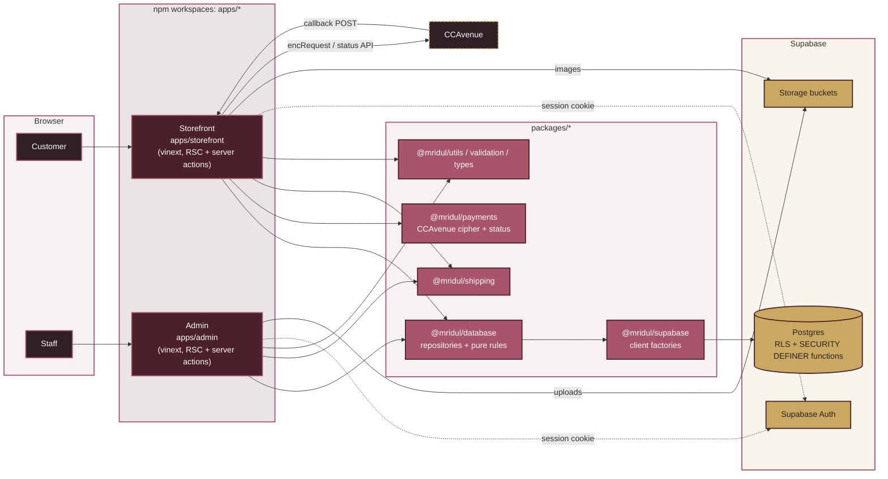
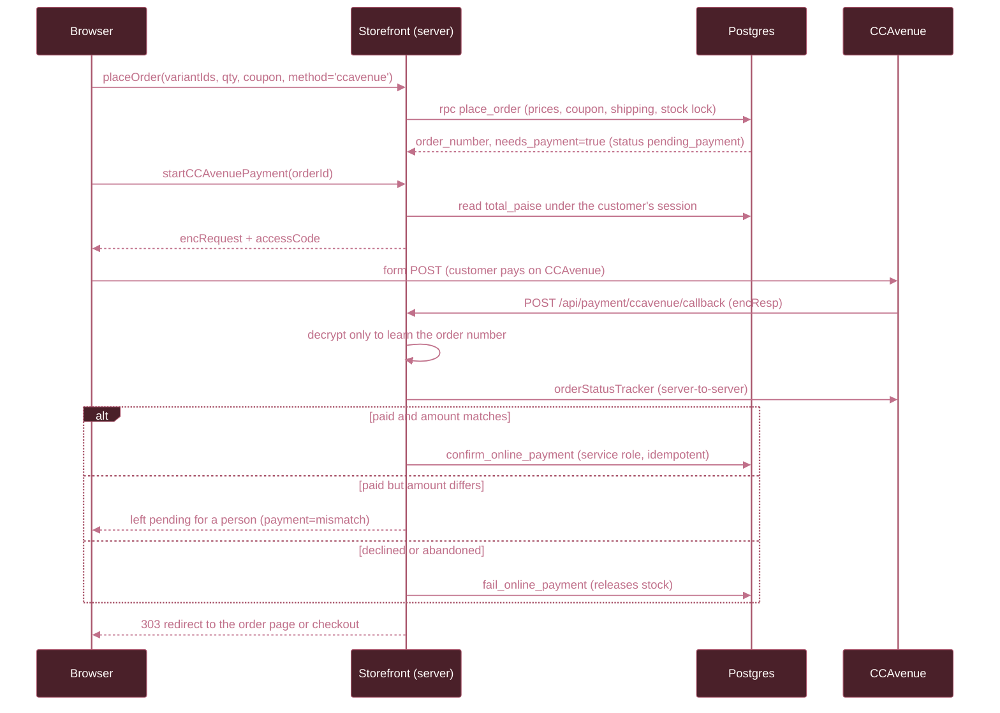

<a id="readme-top"></a>

<p align="center">
  
</p>

<p align="center">
  
</p>

<p align="center">
  A full-stack e-commerce platform for a saree and Indian-clothing label: a customer storefront, a staff back office, and a Supabase/Postgres backend where row-level security and database functions enforce the business rules.
</p>

<p align="center">
  
  
  
  
  
  <br/>
  
  
  
  
  
  <br/>
  
  
  
</p>

<p align="center">
  <a href="#-about">About</a> •
  <a href="#-overview">Overview</a> •
  <a href="#-key-features">Features</a> •
  <a href="#-tech-stack">Tech stack</a> •
  <a href="#-architecture">Architecture</a> •
  <a href="#-getting-started">Getting started</a> •
  <a href="#-usage">Usage</a> •
  <a href="#-how-it-works">How it works</a> •
  <a href="#-testing">Testing</a> •
  <a href="#-deployment">Deployment</a> •
  <a href="#-roadmap">Roadmap</a>
</p>

<br/>

<div align="center">
<table>
  <tr>
    <td align="center"><h3>24</h3><sub>SQL migrations</sub></td>
    <td align="center"><h3>39 / 39</h3><sub>tables under row-level security</sub></td>
    <td align="center"><h3>5</h3><sub>staff roles</sub></td>
    <td align="center"><h3>137</h3><sub>Vitest cases</sub></td>
    <td align="center"><h3>0</h3><sub>floats touching money</sub></td>
  </tr>
</table>
</div>

## 🧵 About

**Mridul by MR** is a complete online home for a saree and Indian-clothing label. It sells sarees, blouses and modern Indian wear through a customer storefront, and the shop is run day to day from a staff back office. Both apps live in one npm-workspaces monorepo and share a single Supabase Postgres database and a set of internal packages.

Small fashion labels lose money in quiet ways. A price edited in the browser, a payment redirect taken at face value, two buyers racing for the last one-of-a-kind piece, a stock count overwritten by a stale form, or the wrong cash-on-delivery amount on a parcel can each cost a sale or a customer. Mridul is built so those mistakes are refused by the system, instead of hoping the interface prevents them.

The rules live in **Postgres**, not in the UI. All 39 tables run under row-level security, and customers have no direct write rights on orders or payments. An order can only be created through the `place_order` database function, which reads prices, discounts and shipping itself and locks the stock it sells. Online payments through CCAvenue are confirmed only after the server asks the gateway for the real status over its own connection. The browser redirect is never taken as proof. Money is stored as whole **paise**, never as floating-point numbers.

The back office is just as careful:
- Staff work under five roles, and a trigger always keeps at least one owner in place.
- Stock edits use compare-and-set, so a sale made while a form was open is never overwritten.
- Packing slips print the correct cash-on-delivery amount.
- Every sensitive action lands in an append-only audit log.

On the surface it is a modern stack: React 19, vinext on Vite and Tailwind 4, deployable to Cloudflare Workers or Vercel, with 24 SQL migrations and 137 Vitest cases behind it.

## 📖 Overview

**Mridul by MR** is an online shop for sarees, blouses and modern Indian clothing. The repository is an npm-workspaces monorepo with two web apps that share one database and a set of internal packages:

- **Storefront** (`apps/storefront`): the customer-facing shop. It has the catalogue, filters and search, bag and wishlist, sign-in, checkout (cash on delivery or online payment through CCAvenue), order tracking and returns.
- **Admin** (`apps/admin`): the back office. Staff use it for orders, packing slips, dispatch, stock, products and photos, collections, homepage content, the journal, discount codes, returns, staff access and an audit trail.

**The problem it addresses.** In a small shop, mistakes with money and stock are costly and easy to miss: a client-supplied price, a payment redirect taken at face value, two buyers getting the last one-of-a-kind piece, a stock count overwritten by a stale form, or a cash-on-delivery amount copied wrongly onto a parcel.

**The approach.** The rules that matter live in **Postgres**, not in the UI:

- Every table has row-level security (RLS) enabled.
- Customers have no `INSERT` or `UPDATE` rights on orders or payments. An order can only be created through the `place_order` `SECURITY DEFINER` function. It reads prices, the discount and the shipping charge itself, and it locks stock.
- Online payment is confirmed only after the server asks CCAvenue for the order status over its own connection. The browser redirect is never treated as proof that money arrived.
- Staff permissions come from an `admin_roles` table with five roles. A trigger stops the shop from removing its last owner.

Money is stored everywhere as an integer count of **paise** (`bigint`), never as a float.

<!-- Screenshot placeholder: storefront homepage -->
<!-- Screenshot placeholder: admin "Start" page -->

## ✨ Key Features

### Storefront

<table>
  <tr>
    <td width="33%" valign="top">🔎 <b>Catalogue and listings</b><br/>Category (<code>/shop/[category]</code>), collection (<code>/collections/[slug]</code>) and search (<code>/search?q=</code>) pages share one listing engine. It supports filters for fabric, colour, occasion, collection, price range, in-stock and on-sale, plus facet counts, sorting and pagination. Filter state lives in the URL, so a filtered listing can be shared and is rendered on the server.</td>
    <td width="33%" valign="top">🥻 <b>Product pages</b><br/>A gallery, variants with per-variant stock, a "sold out" state, related products, and a pincode delivery check. The shipping estimate uses the same rates as the bag.</td>
    <td width="33%" valign="top">👜 <b>Bag and wishlist</b><br/>Kept in <code>localStorage</code> and synced across tabs. Prices stored there are for display only. "Buy now" checks out a single piece without touching the bag.</td>
  </tr>
  <tr>
    <td width="33%" valign="top">🏷️ <b>Discount codes</b><br/>Previewed through a server action (<code>validate_coupon</code>) and re-validated by the database when the order is placed.</td>
    <td width="33%" valign="top">👤 <b>Accounts</b><br/>Email/password and Google OAuth through Supabase Auth, plus a saved default delivery address with Indian phone and pincode validation.</td>
    <td width="33%" valign="top">💳 <b>Checkout</b><br/>Cash on delivery always. CCAvenue online payment is offered only when its credentials are configured on the server.</td>
  </tr>
  <tr>
    <td width="33%" valign="top">🚚 <b>Order pages</b><br/>Status timeline, retry payment for an unpaid online order, and return requests for selected items within the return window.</td>
    <td width="33%" valign="top">📰 <b>Editorial content</b><br/>The hero, mood tiles, occasion panels, brand story, testimonials and journal all come from the database. The order of homepage sections is data, not code.</td>
    <td width="33%" valign="top">💬 <b>Help panel</b><br/>A scripted FAQ with no AI model behind it. Shipping and return answers use figures from Settings, and the catalogue answers ("What is new?", fabrics, lowest price) come from live products.</td>
  </tr>
  <tr>
    <td width="33%" valign="top">🌐 <b>SEO</b><br/>A dynamic <code>sitemap.xml</code> built from the catalogue and journal, a <code>robots.txt</code> that keeps private pages out of the index, and Open Graph metadata.</td>
    <td width="33%" valign="top">🤖 <b>Agent tools</b><br/>If the browser exposes <code>document.modelContext</code>, the homepage registers two tools, <code>add_featured_product_to_bag</code> and <code>toggle_featured_product_wishlist</code>. They only change the local bag and wishlist.</td>
  </tr>
</table>

### Admin

<table>
  <tr>
    <td width="33%" valign="top">📋 <b>Start page</b><br/>A ranked "what needs doing today" list. It covers unpaid orders holding stock, orders to pack, open returns, shipments out too long, and low stock.</td>
    <td width="33%" valign="top">🧾 <b>Orders</b><br/>List and detail views, status changes through <code>admin_set_order_status</code>, staff notes, dispatch recording (courier plus AWB, with tracking links built for known couriers), and marking orders delivered.</td>
    <td width="33%" valign="top">📦 <b>Packing</b><br/>Printable A4 packing slips, one per order, oldest first. Unpaid orders are left out, and the slips show the correct cash-on-delivery amount to collect.</td>
  </tr>
  <tr>
    <td width="33%" valign="top">🧮 <b>Products and stock</b><br/>Edit copy, prices and variants. Stock writes use compare-and-set, so a sale that happened while the form was open is not overwritten. Products can be shown, hidden or marked sold out.</td>
    <td width="33%" valign="top">🖼️ <b>Photos and media</b><br/>Upload to Supabase Storage, crop in the browser before upload, set focal point and alt text, replace a file everywhere it is used, and reorder product images inside a transaction.</td>
    <td width="33%" valign="top">🧩 <b>Content</b><br/>Categories, collections (drag-board membership), homepage sections, hero slides, mood tiles, testimonials, prose blocks and site settings (shipping figures, contact details).</td>
  </tr>
  <tr>
    <td width="33%" valign="top">✍️ <b>Journal</b><br/>Plain-text posts with images and publish/unpublish. Posts are rendered as text, so pasted markup cannot become script.</td>
    <td width="33%" valign="top">🏷️ <b>Discount codes</b><br/>Create and edit codes, set them active or inactive, and see their state (expired, not started, used up). Only the owner can change them.</td>
    <td width="33%" valign="top">👥 <b>Customers</b><br/>Account list and detail through the <code>admin_customers()</code> function, so no service-role key is needed.</td>
  </tr>
  <tr>
    <td width="33%" valign="top">↩️ <b>Returns</b><br/>Approve, decline or record a refund through <code>admin_decide_return</code>. Approving restocks only the returned items.</td>
    <td width="33%" valign="top">🛡️ <b>Staff and audit</b><br/>Grant and revoke roles, with the last owner protected. An append-only audit log records actor and time from the session.</td>
  </tr>
</table>

## 🧰 Tech Stack

<p align="center">
  
</p>

| Layer | Technology | Version (from manifests) |
|---|---|---|
| Language | TypeScript | 5.9.3 |
| UI | React / React DOM | 19.2.6 |
| Framework | [vinext](https://github.com/cloudflare/vinext) (Next.js App Router API on Vite) | 1.0.0-beta.5 |
| Bundler | Vite (+ `@vitejs/plugin-react`, `@vitejs/plugin-rsc`) | 8.0.13 |
| Styling | Tailwind CSS (`@tailwindcss/vite`), hand-written CSS | 4.3.3 |
| UI components (storefront) | shadcn (`base-nova` style) on Base UI, lucide-react icons | shadcn 4.18.0, `@base-ui/react` 1.7.0, lucide-react 1.31.0 |
| Backend / DB | Supabase (Postgres, Auth, Storage) via `@supabase/supabase-js` and `@supabase/ssr` | 2.116.0 / 0.12.7 |
| Payments | CCAvenue (AES-128-CBC request/response plus server-to-server status API) | — |
| Hosting targets | Cloudflare Workers (`@cloudflare/vite-plugin`, Wrangler) and Vercel (Nitro) | plugin 1.37.1, wrangler 4.92.0, nitro 3.0.260903-beta |
| Testing | Vitest | ^5.0.1 |
| Lint / format | oxlint, oxfmt | 1.76.0 / 0.61.0 |
| Scripts | tsx, dotenv | ^4.23.13 / ^17.4.2 |
| Optional | PHP 8.1+ port of the CCAvenue callback (`php/`) | — |
| Runtime | Node.js | >= 22.13.0 |

## 🧩 Architecture



**Data flow in brief**

- **Reads:** server components call `@mridul/database`, which queries Supabase. Public catalogue reads use the anon key, and RLS decides what is visible. Signed-in reads use `sessionClient()` from `@mridul/supabase/server`, which carries the user's cookie, so RLS applies *as that user*.
- **Writes:** server actions call the user's own session client or named Postgres functions (`place_order`, `admin_set_order_status`, `admin_set_stock`, `admin_record_dispatch`, `request_return`, `admin_decide_return`, `record_admin_action`, and so on). The service-role client is used in only two places: the seed script and the CCAvenue callback route, which receives a cross-site POST with no session.
- **Session refresh:** each app has a `proxy.ts` (the renamed Next middleware convention) that refreshes the Supabase session before rendering, so rotated refresh tokens are saved.
- **Workspace packages:** apps consume them as TypeScript source through Vite aliases. Packages have no build step of their own.

### Online payment flow (CCAvenue)



## 📂 Project Structure

<details>
<summary><b>Show the full project tree</b></summary>

```text
mridul/
├── apps/
│   ├── storefront/                 # Customer shop (vinext app, dev port 3000)
│   │   ├── app/
│   │   │   ├── page.tsx            # Homepage: sections ordered by `homepage_sections`
│   │   │   ├── shop/ collections/ search/ product/[slug]/   # Listings and product page
│   │   │   ├── bag/ wishlist/ checkout/                      # Cart, wishlist, checkout + server actions
│   │   │   ├── auth/ account/ order/[number]/                # Sign-in, account, order page, returns
│   │   │   ├── journal/            # Journal index and stories
│   │   │   ├── api/payment/ccavenue/callback/route.ts        # CCAvenue return URL
│   │   │   ├── sitemap.xml/ robots.txt/                      # SEO route handlers
│   │   │   ├── components/         # Header, footer, hero, listing, help chat, etc.
│   │   │   └── providers/store-provider.tsx                 # localStorage bag/wishlist
│   │   ├── components/ui/          # Generated shadcn components (only button and sheet are imported)
│   │   ├── public/images/          # Brand marks, hero and placeholder product art (PNG + WebP)
│   │   ├── proxy.ts                # Supabase session refresh
│   │   ├── vite.config.ts          # vinext + Cloudflare or Nitro target, workspace aliases
│   │   └── vercel.json
│   └── admin/                      # Back office (vinext app, dev port 3001)
│       ├── app/(dashboard)/        # Gated pages: orders, packing, products, inventory, media, ...
│       ├── app/actions/            # Server actions (catalogue, media, orders, returns, staff, audit, ...)
│       ├── app/components/         # Admin UI: crop box, image upload, collection board, parcel slip
│       ├── app/login/              # Email/password + Google sign-in
│       ├── proxy.ts
│       └── vite.config.ts
├── packages/
│   ├── database/       # Repositories (catalogue, content, orders, coupons, staff, returns, audit)
│   │                   # + pure rule modules (attention, packing, journal) + seed data
│   ├── supabase/       # publicClient / adminClient / sessionClient, role helpers, storage URLs
│   ├── payments/       # CCAvenue cipher, request builder, status API; Razorpay-style contract
│   ├── shipping/       # Flat-rate estimate, courier list and tracking-link builder, provider contract
│   ├── notifications/  # WhatsApp-template notification contract (not yet wired to an app)
│   ├── validation/     # URL <-> ProductQuery parsing for listings
│   ├── utils/          # Money/date formatting (IST), colour palette, WhatsApp links, image widths
│   └── types/          # Domain types + Supabase `Database` types
├── supabase/
│   ├── migrations/     # 0001–0024 SQL migrations (schema, RLS, functions, storage)
│   └── README.md       # Schema rules and how to apply them
├── php/                # Optional PHP 8.1 implementation of the CCAvenue callback
├── scripts/
│   ├── seed-supabase.ts        # Idempotent seed of catalogue, content, media and coupons
│   ├── shrink-local-images.ts  # Re-encodes public images to WebP (uses sharp)
│   └── backups/                # JSON snapshots of product image/rating rows
├── tests/              # Vitest unit tests for the pure business rules
├── DEPLOY.md           # Vercel and Cloudflare deployment notes
├── .env.example
├── vitest.config.ts
└── package.json        # Workspace root and scripts
```

</details>

## 🚀 Getting Started

### Prerequisites

- **Node.js 22.13 or later** and npm (the repo uses npm workspaces and ships a `package-lock.json`)
- A **Supabase** project (Postgres, Auth, Storage)
- The **Supabase CLI** if you want to apply migrations with `supabase db push` (you can also paste them into the SQL editor)
- *(Optional)* CCAvenue merchant credentials for online payment
- *(Optional)* PHP 8.1+ with `openssl`, `curl` and `pdo_pgsql` if you use the PHP callback in `php/`

### 1. Install

```bash
git clone https://github.com/RohitMunnuru9/mridul.git
cd mridul
npm install
```

> [!TIP]
> Run the install from the repo root so the `packages/*` workspaces are linked.

### 2. Configure environment

```bash
cp .env.example .env.local
```

Both apps' Vite configs and the seed script read a **single `.env.local` at the repo root**.

| Variable | Used by | Required | Purpose |
|---|---|---|---|
| `NEXT_PUBLIC_SUPABASE_URL` | both apps, seed | Yes (build fails without it) | Supabase project URL; also allow-listed for `next/image` |
| `NEXT_PUBLIC_SUPABASE_ANON_KEY` | both apps | Yes (build fails without it) | Anon/publishable key. RLS protects the data |
| `NEXT_PUBLIC_STOREFRONT_ORIGIN` | storefront | Recommended (required for CCAvenue) | Public origin for auth callbacks, the CCAvenue return URL and `metadataBase` |
| `NEXT_PUBLIC_ADMIN_ORIGIN` | admin | Recommended in production | Origin for the admin's Google OAuth callback (falls back to the Host header) |
| `SUPABASE_SERVICE_ROLE_KEY` | seed script, CCAvenue callback route | For seeding / online payment | **Secret.** Bypasses RLS. Server-only, never `NEXT_PUBLIC_` |
| `CCAVENUE_MERCHANT_ID` | storefront | Optional | Enables online payment when all three CCAvenue values are set |
| `CCAVENUE_ACCESS_CODE` | storefront | Optional | CCAvenue access code |
| `CCAVENUE_WORKING_KEY` | storefront | Optional | **Secret.** Encrypts requests and decrypts responses |
| `CCAVENUE_ENV` | storefront | Optional | Set to `test` to use CCAvenue's sandbox hosts |

Example `.env.local`:

```dotenv
NEXT_PUBLIC_SUPABASE_URL=https://YOUR_PROJECT_REF.supabase.co
NEXT_PUBLIC_SUPABASE_ANON_KEY=your-anon-or-publishable-key
NEXT_PUBLIC_STOREFRONT_ORIGIN=http://localhost:3000
NEXT_PUBLIC_ADMIN_ORIGIN=http://localhost:3001

# Server-only secrets
SUPABASE_SERVICE_ROLE_KEY=your-service-role-or-secret-key

# Optional: online payment
# CCAVENUE_MERCHANT_ID=
# CCAVENUE_ACCESS_CODE=
# CCAVENUE_WORKING_KEY=
# CCAVENUE_ENV=test
```

> [!NOTE]
> A comment in `.gitignore` says the storefront dev server runs on `workerd`, which does not see `.env.local` at runtime. Server-side secrets reach it through Wrangler's `.dev.vars` file instead, which is also gitignored. Put runtime-only secrets such as the CCAvenue values there when you test locally.

`.env.example` also lists commented-out placeholders for Razorpay and WhatsApp. No code reads them yet.

### 3. Set up the database

```bash
supabase link --project-ref YOUR_PROJECT_REF
supabase db push
```

This applies `supabase/migrations/0001`–`0024` in order. Then grant yourself the owner role in the SQL editor (use your own email):

```sql
insert into public.admin_roles (user_id, role)
select id, 'super_admin' from auth.users where email = 'you@example.com';
```

> [!IMPORTANT]
> The account must have signed in at least once so that it exists in `auth.users`.

### 4. Seed catalogue and content (optional)

```bash
npm run seed
```

`scripts/seed-supabase.ts` uses the service-role key. It uploads the images in `apps/storefront/public/images` to Storage and upserts categories, collections, products, homepage content, content blocks and coupons. It upserts on natural keys, so you can run it again safely.

### 5. Run

```bash
npm run dev          # storefront  -> http://localhost:3000
npm run dev:admin    # admin       -> http://localhost:3001
```

### Available scripts (root)

| Script | What it does |
|---|---|
| `npm run dev` / `npm run dev:admin` | Start the storefront / admin dev server (`vinext dev`) |
| `npm run build` / `npm run build:admin` | Production build (`vinext build`). Targets Cloudflare Workers unless `VERCEL=1` or `NITRO_PRESET` is set |
| `npm run build:vercel` / `npm run build:vercel:admin` | `vite build` through Nitro for Vercel |
| `npm start` | Serve the built storefront with `wrangler dev --config dist/server/wrangler.json` |
| `npm test` / `npm run test:watch` | Run the Vitest suite once / in watch mode |
| `npm run typecheck` | `tsc --noEmit` for both apps |
| `npm run lint` / `npm run format` | oxlint / oxfmt |
| `npm run seed` | Seed Supabase (see above) |

## 💻 Usage

### Storefront routes

| Route | Description |
|---|---|
| `/` | Homepage (sections and their order come from `homepage_sections`) |
| `/shop`, `/shop/[category]` | Shop index; category listing with filters |
| `/collections/[slug]` | Collection listing (e.g. new arrivals, best sellers) |
| `/search?q=` | Search results (same filters as listings) |
| `/product/[slug]` | Product detail, variants, delivery check |
| `/bag`, `/wishlist` | Bag (with coupon preview) and wishlist |
| `/auth` | Sign in / sign up / Google |
| `/checkout` | Delivery details and place order (COD or CCAvenue) |
| `/account` | Customer's orders and details |
| `/order/[number]` | Order status, retry payment, request a return |
| `/journal`, `/journal/[slug]` | Journal index and story pages |
| `/sitemap.xml`, `/robots.txt` | Generated SEO files |

**Listing query parameters** (parsed in `packages/validation`): `fabric`, `colour`, `occasion`, `collection` (repeatable), `min` / `max` (rupees), `stock=in`, `sale=1`, `sort` (`featured`, `newest`, `price_asc`, `price_desc`, `discount`), `page`. Results are paged 8 per page.

### HTTP endpoints

| Method | Path | App | Purpose |
|---|---|---|---|
| `POST` | `/api/payment/ccavenue/callback` | storefront | CCAvenue redirect and cancel URL. Verifies payment server-to-server, then confirms or fails the order |
| `GET` | `/api/payment/ccavenue/callback` | storefront | Redirects to `/account?payment=cancelled` |
| `GET` | `/auth/callback` | both | Supabase email-verification / OAuth code exchange |
| `GET` | `/sitemap.xml`, `/robots.txt` | storefront | Generated from the catalogue / a fixed disallow list |
| `GET` | `/robots.txt` | admin | Disallows everything |

Everything else (placing orders, saving addresses, coupons, returns, all admin writes) is done with **server actions**, not REST endpoints.

### Admin sections

`/` Start · `/orders` (and `/orders/[id]`, `/orders/[id]/slip`) · `/packing` · `/products` (and `/products/[id]`) · `/customers` (and `/customers/[id]`) · `/inventory` · `/coupons` · `/categories` · `/collections` · `/media` · `/homepage` · `/journal` · `/settings` · `/staff` · `/activity`

The `(dashboard)` layout gates every page. A signed-in user with no row in `admin_roles` is turned away. Roles:

| Role | Scope (enforced by RLS policies) |
|---|---|
| `super_admin` | Everything, including `admin_roles`, coupons and the audit log |
| `catalog_manager` | Products, variants, stock, collections |
| `order_manager` | Orders, dispatch, returns |
| `content_manager` | Homepage, journal and other editorial content |
| `support` | Read-only |

## 🧠 How It Works

### Database as the enforcement point

The schema is in `supabase/migrations`. The key pieces:

- **`place_order`** (0016, extended in 0017) is the only way to create an order. The browser sends variant ids and quantities. The function reads unit prices from `products` and `product_variants`, re-runs `validate_coupon` against its own subtotal, reads shipping from `settings`, locks and decrements `inventory` row by row, and writes the totals. A check constraint (`orders_total_adds_up`) verifies the arithmetic.
- **Order numbers** come from a sequence through `next_order_number()` (format `MR-YYYY-NNNNNN`). The primary key stays a UUID.
- **Stock is deducted when the order is placed**, so two people cannot both pay for a one-off piece. `fail_online_payment` and cancellation restore it, and approved returns restock only the returned lines.
- **`admin_set_stock`** (0019) uses compare-and-set. It refuses the write if the shelf count changed since the form was loaded.
- **Image ordering** (0020) renumbers a product's images in one transaction using a deferrable unique constraint.
- **`keep_one_super_admin`** (0022) is a locking trigger that prevents removing the last owner.
- **`record_admin_action`** (0023) writes to the append-only audit log. It takes the actor from the session, so a caller cannot pass or spoof it.

### CCAvenue integration

`packages/payments/src/ccavenue.ts` implements CCAvenue's scheme: AES-128-CBC, a key that is the raw MD5 of the working key, and a fixed published IV. Values are sanitised so `&`, `=` and newlines cannot inject extra fields. Because the scheme has no MAC, the decrypted redirect is used only to find the order number. Payment is settled by `fetchOrderStatus`, a server-to-server call to CCAvenue's `orderStatusTracker`. Both the callback route and `confirm_online_payment` check that the paid amount equals `orders.total_paise`. The module throws if it is imported in a browser.

`php/` contains an equivalent PHP implementation (`public/callback.php`, `src/`) for PHP hosting, plus `php/test-crypto.php`, a known-answer cipher test. The TypeScript and PHP code share the same test vectors (see `tests/ccavenue-cipher.test.ts`). `php/README.md` describes the least-privilege database role it expects. Use one implementation or the other, not both.

### "Is this order paid for?"

`isPaidFor` in `packages/database/src/orders.ts` decides this for the whole shop, and it mirrors the test the database applies before dispatch. Cash counts once it has been collected. An online payment counts only once it has been **verified** against the gateway. A payment row that merely says `paid` is not enough.

### Packing slips

`packages/database/src/packing.ts` turns an order into the parcel documents. It works out how much cash the courier should collect, whether the order should be packed at all (unpaid orders are excluded), and which of the order's two notes the customer is allowed to see. It is a pure module, and `tests/packing.test.ts` covers it.

### Images

Product photography is served from public Supabase Storage buckets (`products`, `collections`, `banners`, `homepage`, `media`) through Supabase's image-render endpoint. `storageUrl()` requests a width and quality, and `imageAtWidth()` snaps each slot to a fixed set of widths so files stay cached across pages.

## 🧪 Testing

```bash
npm test
```

Vitest runs `tests/**/*.test.ts` in a Node environment. The suite covers the pure rules where a mistake is costly and easy to miss:

| Test file | Covers |
|---|---|
| `ccavenue-cipher.test.ts` | Known-answer vectors for the CCAvenue cipher and payload injection |
| `is-paid-for.test.ts` | When an order counts as paid |
| `money-and-promises.test.ts` | Shipping thresholds, money formatting, WhatsApp and tracking links |
| `coupons.test.ts` | Coupon state (active, expired, not started, used up) |
| `packing.test.ts` | COD amount, ready-to-send rule, customer-visible notes |
| `returns.test.ts` | Return-window eligibility |
| `staff-access.test.ts` | Role grant/revoke rules and last-owner protection |
| `attention.test.ts` | Start-page "needs attention" ranking |
| `audit-trail.test.ts` | Human-readable audit diffs |
| `journal.test.ts` | Journal links, slugs, paragraphs, reading time |

> [!NOTE]
> Database policies and functions have no automated tests. `supabase/README.md` gives a manual SQL check for RLS.

## 🌐 Deployment

See [`DEPLOY.md`](DEPLOY.md) for the full guide. In summary:

- **Vercel:** set up two separate projects from this repo, with Root Directory `apps/storefront` and `apps/admin`, Framework Preset "Other", and Node 22.x. Each app's `vercel.json` runs `npm run build:vercel` and pins the region to `bom1`. Set the `NEXT_PUBLIC_*` variables on both projects. Then add `https://<domain>/auth/callback` for each app to Supabase Auth's redirect allow-list and to the Google OAuth client.
- **Cloudflare Workers:** this is the default build target. To deploy, run `npx @vinext/cloudflare deploy`.
- `next/image` optimisation is a Cloudflare binding. On Vercel, images are passed through at their original size.

> [!WARNING]
> `DEPLOY.md` advises against setting `SUPABASE_SERVICE_ROLE_KEY` on the web projects. The storefront's CCAvenue callback route uses the service-role client, though, so online payment needs that key (and the `CCAVENUE_*` values) in the storefront's server environment. Without them, checkout offers cash on delivery only.

## 🧭 Roadmap

These items are described as future work in the code's own comments:

- **Razorpay:** `packages/payments` defines a `PaymentProvider` contract, and `.env.example` has placeholder keys. It is not implemented yet.
- **WhatsApp notifications:** `packages/notifications` defines events, template names and a fan-out `notify()`. No app calls it yet.
- **Courier integration:** `packages/shipping` defines a `ShippingProvider` interface (serviceability, quotes, shipment booking, tracking). Shipping is currently a flat rate with a free-shipping threshold from Settings.
- **Server-side cart:** the `carts` and `wishlists` tables exist, but the bag is still in `localStorage`. The provider notes that the cart should merge into the server cart on sign-in.
- **Scaling listings:** `supabase-source.ts` loads a category's products and filters them in memory. Its comments say filtering and paging should move into SQL as the catalogue grows.

## 🤝 Contributing

There are no formal contribution guidelines in the repository. If you want to contribute:

1. Fork the repo and create a feature branch.
2. Run `npm run typecheck`, `npm run lint` and `npm test` before opening a pull request.
3. Put any schema change in a new numbered migration in `supabase/migrations/`. Do not edit migrations that have already been applied.

## 📜 License

No license file is included in this repository, so all rights are reserved by the author unless stated otherwise.

## 👤 Author

**Rohit Munnuru**: [github.com/RohitMunnuru9](https://github.com/RohitMunnuru9)

<br/>

<p align="center">
  Built with ❤️ by <a href="https://github.com/RohitMunnuru9"><b>Rohit Munnuru</b></a><br/>
  <sub>If this project helped or impressed you, drop a ⭐ — it really helps!</sub>
</p>
<p align="center"><a href="#readme-top">⬆ Back to top</a></p>
<p align="center">
  
</p>
